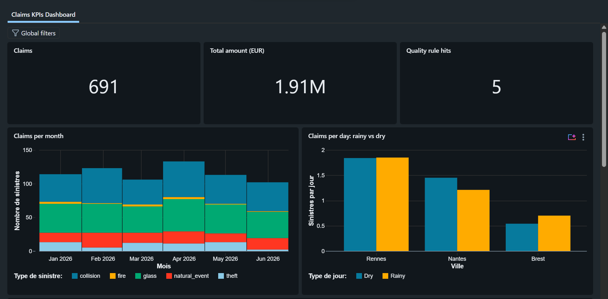
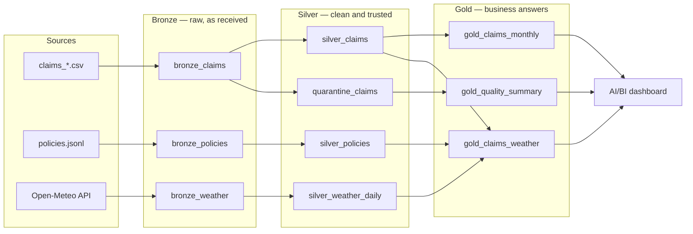

# Auto insurance claims — an end-to-end pipeline on Databricks


**In one sentence:** this project takes raw car-insurance claims, customer
policies and real weather data, cleans them, checks their quality, and turns
them into a dashboard that answers three business questions — all deployed
automatically on Databricks every time the code changes.



---

## 1. The business problem

An insurer's claims team wants to know, every month:

| # | Question | Where the answer lives |
|---|---|---|
| 1 | How many claims, and at what cost, per month and per claim type? | `gold_claims_monthly` |
| 2 | Do we get more claims on rainy days, per city? | `gold_claims_weather` |
| 3 | How many records were rejected by the quality checks, and why? | `gold_quality_summary` |

Question 2 is the interesting one: it needs **three sources joined together**
(a claim has a policy, a policy has a city, a city has weather on a given day).

## 2. The data

| Source | Format | Content | Origin |
|---|---|---|---|
| Claims | 6 CSV files (one per month, Jan → Jun 2026) | `claim_id`, `policy_id`, date, amount, type, status | Synthetic, generated by `data_gen/generate_data.py` |
| Policies | 1 JSON Lines file | `policy_id`, city, vehicle type, premium | Synthetic |
| Weather | JSON from a public API | Daily precipitation for Rennes, Nantes, Brest | Real data, [Open-Meteo](https://open-meteo.com/) archive (no API key) |

The generator **deliberately injects problems** a real pipeline must survive:
negative amounts, an impossible date (`2026-02-30`), a wrong date format
(`31/03/2026`), a claim pointing to a policy that does not exist, and claims
re-sent in a later file (duplicates).

## 3. How it works: the Medallion architecture



| Layer | What happens | Why |
|---|---|---|
| **Bronze** | Files are loaded as they are, every column as text, with two lineage columns: which file (`_source_file`) and when (`_ingested_at`). Ingestion uses **Auto Loader**: only new files are read on each run. | Never lose the original. If a rule changes, Silver can be rebuilt from Bronze. |
| **Silver** | Columns get real types (dates, decimals). Duplicates are removed (latest version wins). Each row is checked against 8 named quality rules. Valid rows go to `silver_claims`; invalid ones go to `quarantine_claims` with the broken rule(s) in `dq_reason`. | Bad data is **isolated, not deleted**: the business can see and fix it. |
| **Gold** | One small table per business question. Rainy-day claims are divided by the number of rainy days (and same for dry days), so cities with more dry days don't look biased. | Dashboards and analysts read only Gold: the business logic is in tested code, not hidden in a chart. |

**Quality rules** (Silver): `missing_claim_id`, `invalid_date`, `future_date`,
`invalid_amount`, `negative_amount`, `unknown_claim_type`, `unknown_status`,
`unknown_policy`. A row can break several rules at once.

## 4. Results

| Step | Rows |
|---|---|
| Claims received (Bronze) | 699 |
| Duplicates removed | 3 |
| Rows quarantined | 5 (2 invalid dates, 2 negative amounts, 1 unknown policy) |
| Valid claims (Silver) | **691** |
| Policies | 300 |

Claims per day, rainy vs dry:

| City | Dry days | Claims / dry day | Rainy days | Claims / rainy day |
|---|---|---|---|---|
| Brest | 87 | 0.54 | 94 | 0.70 |
| Nantes | 105 | 1.45 | 76 | 1.21 |
| Rennes | 103 | 1.84 | 78 | 1.85 |

**Reading:** no consistent rain effect — Brest is higher on rainy days, Nantes
lower, Rennes flat. This is expected: the claims are synthetic and were not
generated with a weather effect. The pipeline answers the question correctly;
with real claims, the same tables would reveal a real effect if there is one.

## 5. Quality and automation

- **Unit tests** (`tests/`, pytest): the Silver and Gold logic is written as
  pure functions (DataFrame in → DataFrame out) and tested on small hand-made
  datasets, run on Databricks serverless through Databricks Connect.
- **Databricks Asset Bundle** (`databricks.yml`, `resources/`): the job
  (5 tasks: setup → fetch weather → bronze → silver → gold) and the dashboard
  are described as code. Two targets: **dev** (schema `claims_dev`) and
  **prod** (schema `claims_prod`) — same code, separate data.
- **CI/CD** (`.github/workflows/ci-cd.yml`, GitHub Actions): on every push to
  `main`, the tests run; **only if they pass**, the bundle is validated,
  deployed to prod and the job is run. A broken test blocks the deployment.
- **No secret in Git**: locally, authentication is `databricks auth login`
  (OAuth in the browser); in CI, a short-lived token is stored as a GitHub
  secret and masked in the logs.
- An equivalent pipeline for **Azure DevOps**, with the token read from
  **Azure Key Vault**, is in `azure-pipelines.yml` (and a simpler variant in
  `ci/`).

## 6. Run it yourself

**Prerequisites:** a Databricks workspace (Free Edition works), Python 3.12,
[uv](https://docs.astral.sh/uv/), the [Databricks CLI](https://docs.databricks.com/dev-tools/cli/install.html).

```bash
# 1. Environment
uv venv --python 3.12 .venv && source .venv/bin/activate
uv pip install -r requirements-dev.txt
databricks auth login --host https://<your-workspace>.cloud.databricks.com

# 2. Data
python data_gen/generate_data.py                       # create the sample files
python jobs/run_setup.py --schema claims_dev           # schema + volumes
python data_gen/upload_to_volume.py --schema claims_dev

# 3. Tests
pytest -v

# 4. Deploy and run (job + dashboard)
databricks bundle deploy -t dev
databricks bundle run -t dev claims_pipeline
databricks bundle summary -t dev                       # links to the job and the dashboard
```

## 7. Repository layout

```
databricks.yml                       bundle: variables, dev / prod targets
resources/claims_job.yml             the 5-task job (serverless)
resources/claims_kpis.dashboard.yml  the AI/BI dashboard resource
dashboards/                          dashboard definition (.lvdash.json) + reference SQL
src/claims/                          transformation logic (bronze, silver, gold, weather)
jobs/                                thin entry points: read → transform → write
tests/                               pytest unit tests
data_gen/                            synthetic data generator + upload to the Volume
.github/workflows/ci-cd.yml          CI/CD with GitHub Actions
azure-pipelines.yml, ci/             CI/CD with Azure DevOps (+ Key Vault)
```

## 8. Design choices, in short

| Choice | Reason |
|---|---|
| Pure functions in `src/`, thin scripts in `jobs/` | The logic can be tested without reading or writing tables. |
| Everything as text in Bronze | Loading never fails on a bad value; typing is a Silver decision. |
| Quarantine instead of drop | Rejected data stays visible and explainable (`dq_reason`). |
| Gold normalised by exposure (claims per day) | Comparing raw counts would mislead. |
| Dashboard in the bundle | Versioned, reviewed and deployed like the code; dev reads dev data, prod reads prod data. |
| CI deploys only after green tests | Nobody can ship a broken rule to prod by mistake. |

## 9. What I would do next

- Run the CI as a **service principal** instead of a personal token.
- Make Silver **incremental** with `MERGE` instead of a full rebuild.
- Turn the quality rules into **Lakeflow Declarative Pipelines expectations**
  and alert when the quarantine rate exceeds a threshold.
- Replace the synthetic claims with a real (anonymised) dataset.

---

*Built by Marc Philippe Gnancadja — [GitHub](https://github.com/Marc-Philippe-dev) · [LinkedIn](https://www.linkedin.com/in/marc-philippe-gnancadja)*